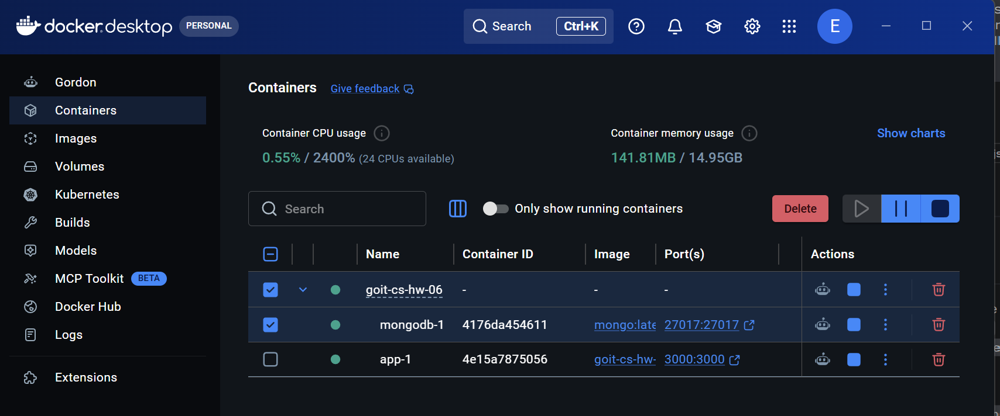
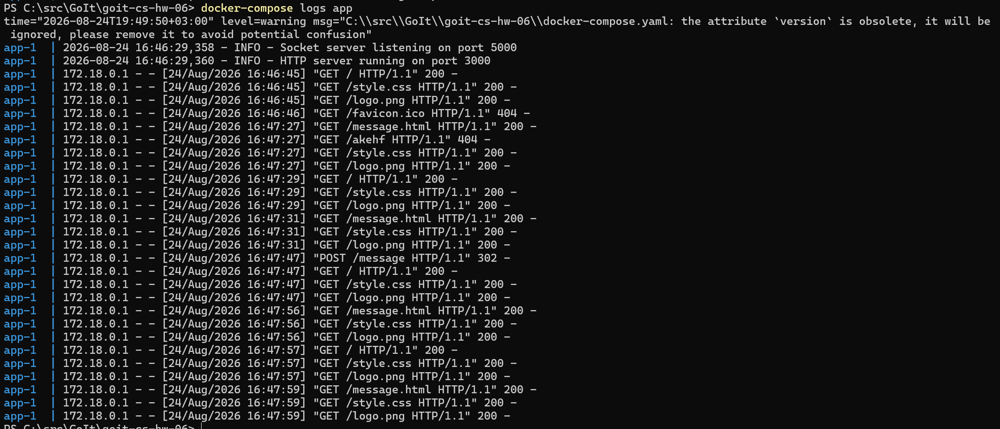
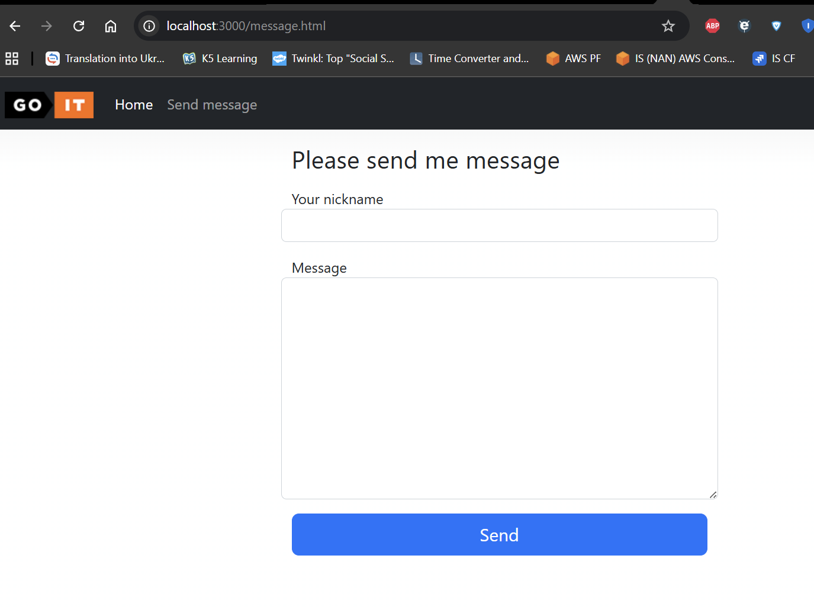
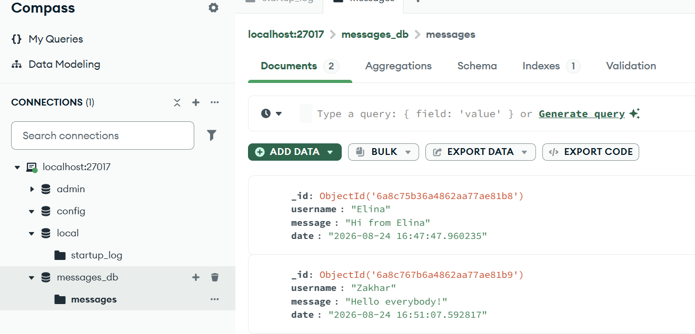

1. 'main.py':

* HTTP-сервер (HTTPHandler): Працює на порту 3000 без сторонніх вебфреймворків (використовує http.server.HTTPServer).
    * Маршрутизація для сторінок (`/`, `/index.html`, `/message`, `/message.html`).
    * Обробка статичних ресурсів (`style.css`, `logo.png`).
    * Повернення сторінки `error.html` із кодом відповіді `404` у разі відсутності ресурсу.
    * Форма на `/message.html` надсилає POST-запит, який передається UDP-сокетом на Socket-сервер (порт 5000).
* Socket-сервер (`run_socket_server`): Працює на порту 5000.
    * Отримує дані у байтовому вигляді, розшифровує їх та перетворює на словник.
    * Додає ключ `"date"` із поточним часом (`str(datetime.now())`).
    * Зберігає документ у базу даних MongoDB (`messages_db.messages`).
* Паралельні процеси: HTTP-сервер та Socket-сервер запускаються в окремих процесах за допомогою
  `multiprocessing.Process`.

2. `Dockerfile`:

* Контейнеризує Python-додаток.
* Встановлює залежності із `requirements.txt`.
* Відкриває порт 3000.

3. `docker-compose.yaml`:

* Описує сервіси `app` та `mongodb`.
* Використовує Docker Volume `mongo_data` для збереження даних MongoDB поза контейнером.

4. Запуск додатка:
   `docker-compose up --build`

 

 

 

 
